# Extension Screenshots

## add-data-api-builder

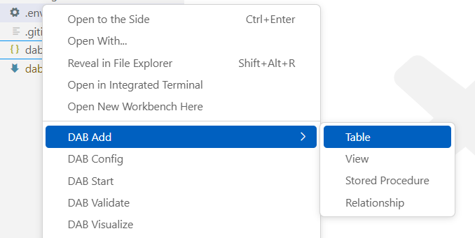

## agent-data-api-builder

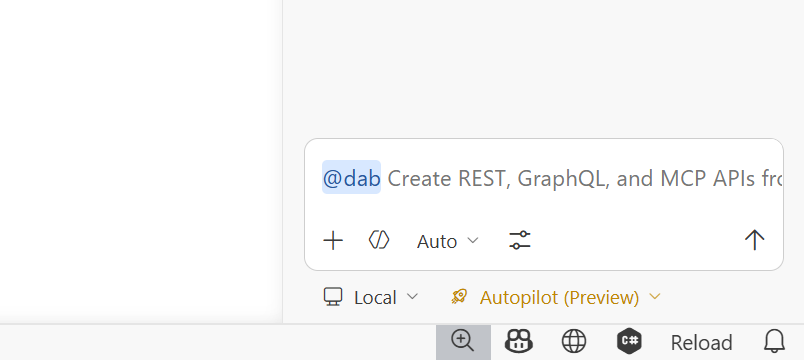

## docker-data-api-builder

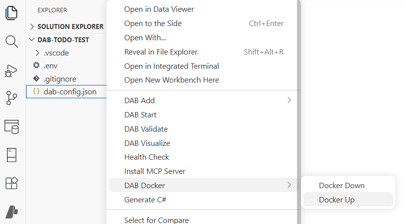

## health-data-api-builder

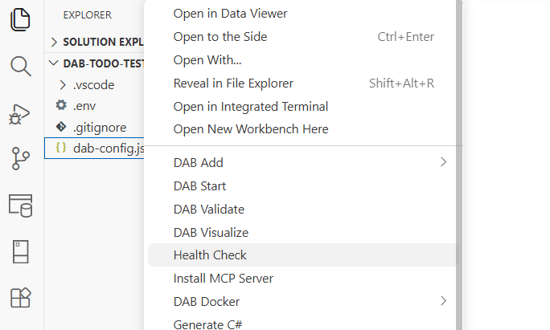

## init-data-api-builder

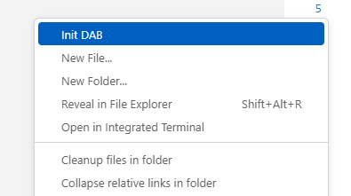

## mcp-data-api-builder

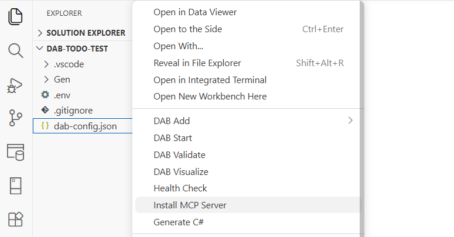

## omnibus-data-api-builder

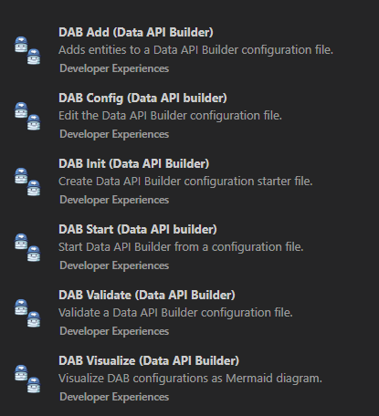

## poco-data-api-builder

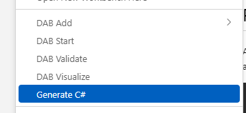

## start-data-api-builder

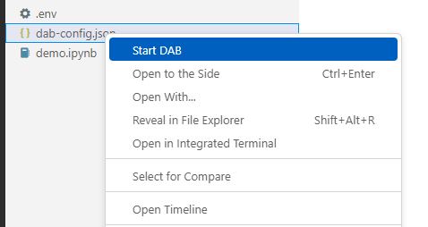

## validate-data-api-builder

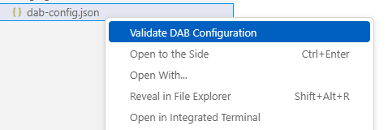

## visualize-data-api-builder

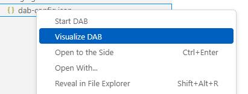

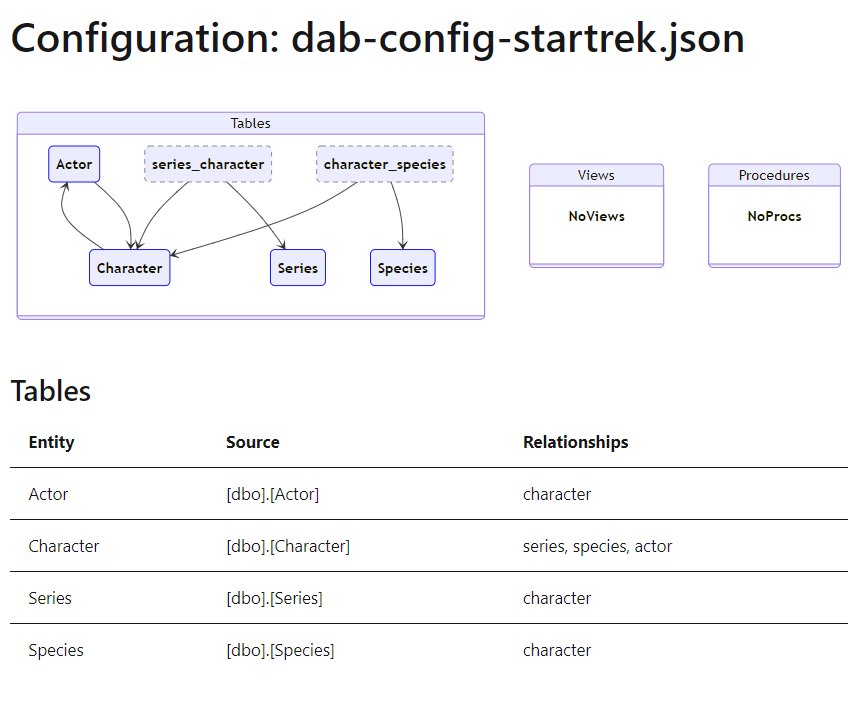

## Extensions without screenshots

- **shared** — No screenshot
- **shared-database** — No screenshot
